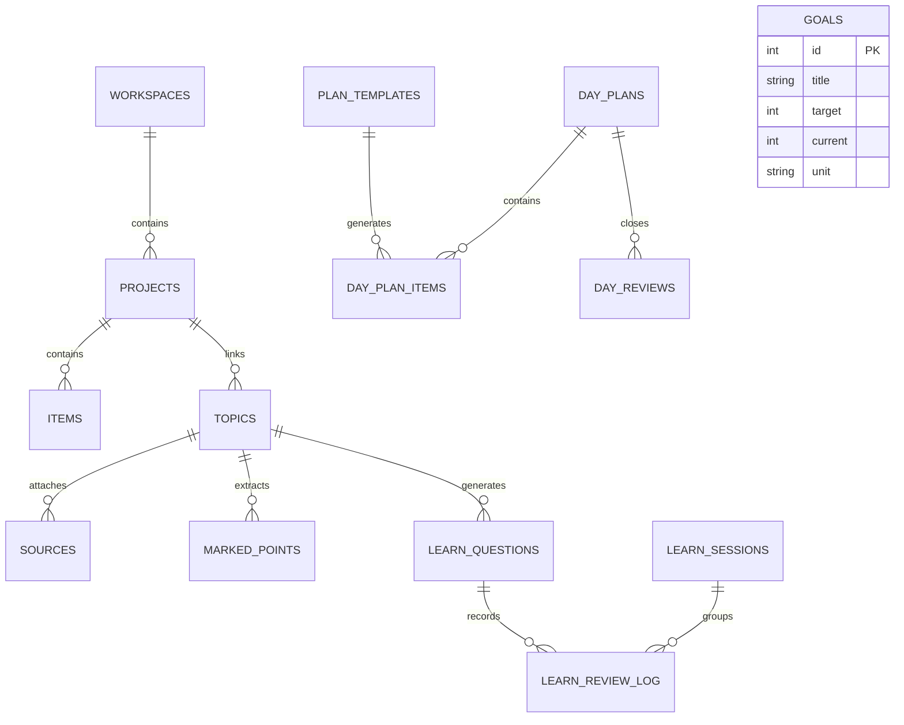

# DELIVERABLE 1 — CURRENT PRODUCT REALITY

## 1. Executive Product Overview
Nimo is a personal, offline-first self-development environment for Android and Linux desktop. It is built using Flutter and backed by a local SQLite relational database (`sqflite`). It requires no accounts, no authentication, no network connectivity, and relies on **zero cloud or third-party servers**.

The application is structured around a deliberate daily cycle:
$$\text{Morning Plan} \longrightarrow \text{Execution \& Capture} \longrightarrow \text{Deliberate Practice} \longrightarrow \text{Evening Day Close} \longrightarrow \text{Quiet Progress Tracking}$$

---

## 2. Shell Navigation & Top-Level Destinations
The primary navigation shell ([`main.dart`](file:///home/Asif/Downloads/Nomi%202/nimo-os-test/lib/main.dart#L440-L515)) employs a standard bottom `NavigationBar` on mobile screens (< 600dp width) and transitions to a vertical `NavigationRail` on larger displays (≥ 600dp width).

### The Four Starting Destinations in Code:
1. **Today (`TodayScreen` — [`lib/features/today/today_screen.dart`](file:///home/Asif/Downloads/Nomi%202/nimo-os-test/lib/features/today/today_screen.dart)):**
   - **Label:** `Today` (Icon: `Icons.today_outlined` / `Icons.today`)
   - **Role:** Daily execution dashboard ("Hub Home"). Combines morning check-in, the day's active plan items, quick capture buttons, an editorial reading prompt, evening Day Close, and historical summaries.
2. **Learn (`LearnScreen` — [`lib/features/learn/learn_screen.dart`](file:///home/Asif/Downloads/Nomi%202/nimo-os-test/lib/features/learn/learn_screen.dart)):**
   - **Label:** `Learn` (Icon: `Icons.school_outlined` / `Icons.school`)
   - **Role:** Deliberate practice and active recall. Houses the spaced repetition session runner, question packs, recent topics, and links to the Topics & Library explorer.
3. **Spaces (`WorkspacesScreen` — [`lib/features/workspaces/workspaces_screen.dart`](file:///home/Asif/Downloads/Nomi%202/nimo-os-test/lib/features/workspaces/workspaces_screen.dart)):**
   - **Label:** `Spaces` (Icon: `Icons.folder_outlined` / `Icons.folder`)
   - **Role:** Personal knowledge base and workbench organized hierarchically: `Workspace → Projects → Items (Notes, Checklists, Links, HTML)`.
4. **Direction / Progress (`DirectionScreen` — [`lib/features/direction/direction_screen.dart`](file:///home/Asif/Downloads/Nomi%202/nimo-os-test/lib/features/direction/direction_screen.dart)):**
   - **Label:** `Direction` (Icon: `Icons.explore_outlined` / `Icons.explore`)
   - **Role:** Houses two secondary tabs:
     - **Goals:** Measurable milestones with incremental `−`/`+` steppers.
     - **Progress:** Visual journey stones, 2-signal streak logic, dual score graphs (Done Score vs. Self Score), and weekly reflection summaries.

---

## 3. Comprehensive Screen & Component Inventory

| Screen Name | File Path | Entry Route | Purpose | Verified Implementation Status |
|---|---|---|---|---|
| **TodayScreen** | `lib/features/today/today_screen.dart` | Shell Tab 0 | Daily planning, execution, and quick add | **Fully Implemented** (2,109 lines) |
| **RoutineScreen** | `lib/features/today/routine_screen.dart` | Today → "Edit routine →" | Habit templates, recurrence, If-Then line | **Fully Implemented** (542 lines) |
| **DayCloseScreen** | `lib/features/review/day_close_screen.dart` | Today → Day Close banner | 4-step evening reflection & dual scoring | **Fully Implemented** (434 lines) |
| **LearnScreen** | `lib/features/learn/learn_screen.dart` | Shell Tab 1 | Practice launcher, review queue, topics | **Fully Implemented** (470 lines) |
| **TopicsScreen** | `lib/features/learn/topics_screen.dart` | Learn → "All topics →" | 2-tab view: Topic management & Library files | **Fully Implemented** (519 lines) |
| **TopicDetailScreen** | `lib/features/learn/topic_detail_screen.dart` | Topics → Tap topic | Topic sources, reading, cloze card generation, topic practice | **Fully Implemented** (573 lines) |
| **ReadingScreen** | `lib/features/learn/reading_screen.dart` | Topic Detail → Tap source | Card-by-card text reader with mark-a-point cloze extractor | **Fully Implemented** (367 lines) |
| **PdfSourceScreen** | `lib/features/learn/pdf_source_screen.dart` | Topic Detail → Tap PDF | Embedded PDF viewer (`pdfrx`) | **Fully Implemented** (214 lines) |
| **SessionScreen** | `lib/features/learn/session_screen.dart` | Learn → Start session | 16-card spaced repetition session with 7 question types | **Fully Implemented** (920 lines) |
| **ImageVerifyListScreen**| `lib/features/learn/image_verify_screen.dart` | Learn → "image targets to check" | Visual coordinate verification for tap-on-image questions | **Fully Implemented** (280 lines) |
| **WorkspacesScreen** | `lib/features/workspaces/workspaces_screen.dart`| Shell Tab 2 | High-level life area containers & recent projects | **Fully Implemented** (319 lines) |
| **ProjectsScreen** | `lib/features/projects/projects_screen.dart` | Spaces → Tap Workspace | Project listings within a workspace | **Fully Implemented** (245 lines) |
| **ItemsScreen** | `lib/features/items/items_screen.dart` | Projects → Tap Project | Lists notes, checklists, links, HTML, and linked topics | **Fully Implemented** (467 lines) |
| **ItemDetailScreen** | `lib/features/items/item_detail_screen.dart` | Items → Tap Item | Document editor (plain-text note, checklist, link preview, HTML sandbox) | **Fully Implemented** (1,025 lines) |
| **HtmlQuizPlayerScreen**| `lib/features/items/html_quiz/html_quiz_player_screen.dart` | Item Detail → Fullscreen | Hardened WebView sandbox for interactive HTML packages | **Fully Implemented** (215 lines) |
| **DirectionScreen** | `lib/features/direction/direction_screen.dart` | Shell Tab 3 | Container for Goals and Progress tabs | **Fully Implemented** (135 lines) |
| **GoalsScreen** | `lib/features/goals/goals_screen.dart` | Direction → Goals Tab | Scalar outcome goal tracking | **Fully Implemented** (155 lines) |
| **ProgressScreen** | `lib/features/progress/progress_screen.dart` | Direction → Progress Tab | Journey map, streak fold, dual score charts, calendar grid | **Fully Implemented** (480 lines) |
| **WeeklySummaryScreen**| `lib/features/progress/weekly_summary_screen.dart`| Today / Progress | Sunday weekly retrospective archive | **Fully Implemented** (310 lines) |
| **SettingsScreen** | `lib/features/settings/settings_screen.dart` | Today → Gear Icon | Appearance, local reminders, SAF backup, LAN sync | **Fully Implemented** (337 lines) |
| **OnboardingScreen** | `lib/features/onboarding/onboarding_screen.dart` | Fresh install gate | 3-step introductory walkthrough | **Fully Implemented** (290 lines) |

---

## 4. Database Models & Storage Architecture
Nimo persists data in a single SQLite database (`app_database.db`) using an 8-version migration sequence ([`app_database.dart`](file:///home/Asif/Downloads/Nomi%202/nimo-os-test/lib/core/db/app_database.dart)).

### Core Schema Entities:

1. **Workbench Hierarchy (`workspaces`, `projects`, `items`):**
   - Items support four distinct polymorphic types: `note`, `checklist`, `link_card`, and `html_quiz`.
   - Notes store raw text bodies.
   - Checklists store items serialized in JSON inside `payload`.
2. **Daily Execution (`plan_templates`, `day_plans`, `day_plan_items`):**
   - Habits are stored as recurring templates (`plan_templates`).
   - A day's active plan (`day_plan_items`) is instantiated for a given date (`dateKey = yyyy-mm-dd`).
   - Unticked one-off tasks carry forward automatically to the next active day (D-002).
3. **Deliberate Learning (`topics`, `sources`, `marked_points`, `learn_questions`, `learn_sessions`, `learn_review_log`):**
   - Spaced repetition engine tracks interval, ease factor, lapses, and next due date per question.
   - Question formats supported in code: `mcq`, `cloze`, `myth_fact`, `flashcard`, `ordering`, `image_point`, `scenario`.
4. **Reflection & Analytics (`day_reviews`, `app_settings`):**
   - Evening Day Close captures a qualitative major point and a user-rated Self Score (1–10).
   - System calculates an objective Done Score (0–100%) based on completed plan tasks.

---

## 5. Verified Feature Status vs. Backlog Plans

### Verified Implemented Features:
- Fully functional local habit tracking, recurring routines, weekday masks, and carry-over.
- Offline document editor with debounced autosave, local conflict detection, and markdown toolbar.
- Spaced repetition flashcard session runner with 7 interactive card types.
- Image-point interaction with aspect-ratio letterbox compensation.
- PDF and plain-text card reader with marked-point cloze extractor.
- Local JSON/database backup and restore with pre-restore safety snapshots.
- Dual-score reflection mathematics and 2-signal streak logic.

### Partially Implemented Features:
- **Global Search:** Local search filters exist inside `TopicsScreen` and `ProjectsScreen`, but there is no universal search capability across all entities.
- **Markdown Rendered Preview:** Toolbar inserts markdown symbols, but notes cannot be toggled into a formatted read-only view.

### Planned / Not Implemented Features:
- **Live P2P Sync (Stage B):** Automatic mDNS/TLS peer sync is documented in decisions but not built; only Stage A manual file import/export exists.
- **Home Screen AppWidget:** Native Android Glance widget code does not exist.
